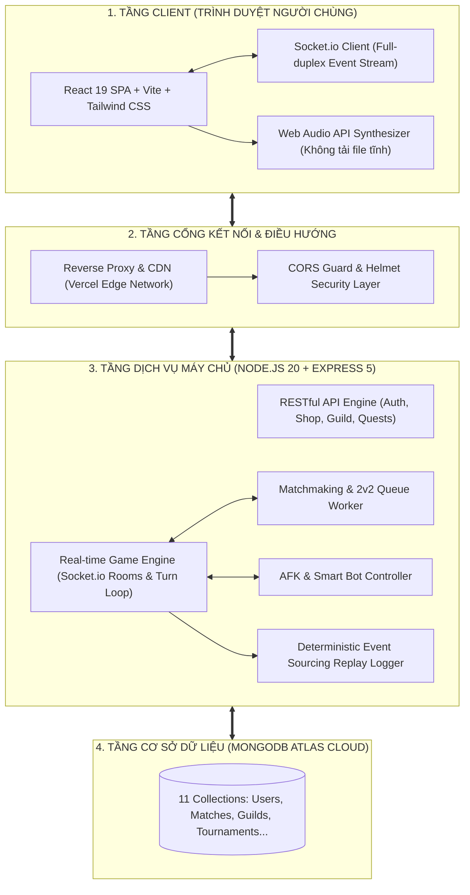

<div align="center">

# 🎮 NEO-UNO
### Nền Tảng Game Bài Đa Người Chơi Trực Tuyến Thời Gian Thực Phong Cách Cyberpunk

[](https://github.com/nguyentronhung0123/NEO-UNO/releases)
[](https://github.com/nguyentronhung0123/NEO-UNO)
[](https://nodejs.org/)
[](https://react.dev/)
[](https://socket.io/)
[](https://tailwindcss.com/)
[](https://www.mongodb.com/)
[](LICENSE)

<br/>

**[🌐 Trải nghiệm Trực tiếp (Live Demo)](https://neo-uno.vercel.app)** •
**[📊 Sơ đồ Trực quan (HTML Viewer)](https://neo-uno.vercel.app/so_do_truc_quan.html)** •
**[📑 Slide Thuyết Trình Đồ Án](https://neo-uno.vercel.app/slide_thuyet_trinh.html)** •
**[🎬 Kịch Bản Video Demo](docs/kich_ban_quay_video_demo.md)** •
**[📖 Báo Cáo Tổng Kết Tuần 6](docs/bao_cao_tuan_6.md)**

</div>

---

## 🌟 GIỚI THIỆU DỰ ÁN

**NEO-UNO** là đồ án tốt nghiệp / dự án chuyên ngành xây dựng nền tảng game thẻ bài trực tuyến thời gian thực hiện đại, lấy cảm hứng từ luật chơi UNO truyền thống nhưng được tái định hình hoàn toàn bằng ngôn ngữ thiết kế viễn tưởng **Cyberpunk 2077** (Dark Mode, ánh sáng Neon Cyan `#00f0ff`, Hot Magenta `#ff007f`, và Lime Accent `#39ff14`).

Dự án giải quyết triệt để các bài toán kỹ thuật phức tạp trong phát triển Web Game phân tán:
1. **Đồng bộ trạng thái thời gian thực Full-duplex:** Sử dụng Socket.io WebSocket, độ trễ phát tán sự kiện $< 15\text{ms}$.
2. **Deterministic State Machine & Anti-cheat:** Máy chủ là nơi duy nhất giữ chân lý (Single Source of Truth), tự động xác thực và chặn đứng mọi hành vi gian lận lượt đi, đánh bài sai luật hoặc mạo danh người chơi.
3. **Cơ chế Đấu Đội 2vs2:** Phối hợp đồng đội thông minh (đồng đội xem được bài nhau, 1 người hết bài thì cả đội chiến thắng).
4. **Hạ tầng AI Bot Backfill & AFK Takeover:** Tự động thế chỗ người chơi mất kết nối, giữ nhịp ván đấu không bao giờ bị gián đoạn.
5. **Hệ thống Âm thanh Tương tác Procedural:** Tổng hợp âm thanh động thông qua Web Audio API (Synthesizer Oscillators) không cần tải tài nguyên âm thanh tĩnh nặng nề.

---

## 🚀 TRUY CẬP HỆ THỐNG ĐÃ TRIỂN KHAI (PRODUCTION)

| Dịch vụ / Tài nguyên | Địa chỉ URL Truy cập | Trạng thái |
| :--- | :--- | :---: |
| **Frontend Web App** | [https://neo-uno.vercel.app](https://neo-uno.vercel.app) |  |
| **Backend REST & WS Server** | [https://neo-uno-backend.onrender.com](https://neo-uno-backend.onrender.com) |  |
| **API Health Check** | [https://neo-uno-backend.onrender.com/api/health](https://neo-uno-backend.onrender.com/api/health) | `{"status":"ok"}` |
| **Sơ đồ Kiến trúc & ERD HTML** | [https://neo-uno.vercel.app/so_do_truc_quan.html](https://neo-uno.vercel.app/so_do_truc_quan.html) | Tương tác 8 Tab |
| **Slide Thuyết Trình Tương Tác** | [https://neo-uno.vercel.app/slide_thuyet_trinh.html](https://neo-uno.vercel.app/slide_thuyet_trinh.html) | 12 Slide + Q&A |

---

## 💎 CÁC TÍNH NĂNG NỔI BẬT (FEATURE MODULES)

### 1. Hệ thống Xác thực & Quản lý Danh tính (Identity & Security)
- Đăng ký, đăng nhập an toàn bằng mã hóa **BCrypt** (10 salt rounds) và **JSON Web Token (JWT)**.
- Tích hợp đăng nhập một chạm với **Google OAuth 2.0**.
- Quên mật khẩu & xác minh danh tính thông qua mã **Email OTP**.
- Kiểm soát phân quyền, chống NoSQL Injection với `express-mongo-sanitize` và phòng vệ XSS / Header tampering với `helmet`.

### 2. Đấu Trường Real-time Multiplayer (1v1 & 2v2 Team Battle)
- **Hàng chờ ghép trận tự động (Matchmaking Queue):** Tự động gom cặp đấu theo chỉ số xếp hạng ELO cân bằng.
- **Chế độ Đấu Đội 2vs2:** 4 người chơi chia làm 2 chiến tuyến (Xanh vs Đỏ). Thành viên trong cùng một đội có thể nhìn thấy bài của nhau để phối hợp chiến thuật; khi bất kỳ thành viên nào hết bài, cả đội lập tức giành chiến thắng.
- **Smart Bot Backfill:** Tự động điền AI Bot thông minh sau 5 giây nếu hàng chờ thiếu người chơi thực, bảo đảm game thủ không bao giờ phải chờ đợi quá lâu.

### 3. Luật UNO Chuẩn Quốc Tế & Thẻ Bài Chức Năng
- Bộ bài 108 lá: Số (0-9), Skip (Bỏ lượt), Reverse (Đảo chiều vòng chơi), Draw Two (+2 lá), Wild (Đổi màu sàn), Wild Draw Four (+4 lá và đổi màu).
- **Cơ chế Hô UNO (UNO Shout):** Khi chỉ còn 1 lá trên tay, người chơi phải nhấn Hô UNO trước khi kết thúc lượt. Nếu bị đối thủ bắt quả tang không hô, server lập tức xử phạt rút thêm 2 lá bài.
- **Cảnh báo Lượt Đi Nguy Cấp:** Bộ đếm ngược 15 giây tích hợp âm thanh nhịp tim đập (Tick-Tock Heartbeat) khi thời gian còn dưới 5 giây.
- **Cơ chế AFK Takeover:** Nếu người chơi mất kết nối hoặc hết giờ mà không đánh, Bot sẽ tự động rút bài hoặc đánh bài hợp lệ thay thế.

### 4. Hệ Thống Giải Đấu Tự Động & Xem Lại Trận Đấu (Tournament & Replay)
- **Đấu Cúp 8 Đội (Bracket Tree):** Tự động bốc thăm chia nhánh Tứ kết, Bán kết, Chung kết. Cập nhật nhánh đấu theo thời gian thực.
- **Replay Engine (Deterministic Event Sourcing):** Lưu toàn bộ luồng sự kiện ván đấu vào cơ sở dữ liệu. Cho phép người chơi và trọng tài tua lại từng lượt đi để phân tích chiến thuật và chống gian lận.

### 5. Hệ Sinh Thái Bang Hội & Mạng Xã Hội (Guilds & Community)
- Tạo và gia nhập Bang hội tự do không rào cản ký tự (cho phép đặt tên có dấu tiếng Việt, ký hiệu đặc biệt, độ dài linh hoạt 1-60 ký tự, tự sinh Clan Tag).
- Bảng xếp hạng Bang hội, Quỹ cống hiến, phòng chat nội bộ bang và danh hiệu đặc quyền.

### 6. Hệ Thống Giữ Chân Người Chơi (Retention Economy)
- **Daily Check-in:** Chuỗi điểm danh nhận thưởng tăng dần trong 7 ngày liên tục.
- **Lucky Wheel:** Vòng quay may mắn vật lý trên Canvas với tỉ lệ trúng thưởng cân bằng thuật toán RNG.
- **Battle Pass (Cyber Pass):** Hệ thống vé chiến đấu 30 cấp độ với cả 2 nhánh phần thưởng Miễn phí và Cao cấp (VIP).
- **Daily & Weekly Quests:** Tự động kích hoạt và cập nhật tiến độ khi người chơi hoàn thành các điều kiện trong trận đấu.

### 7. Cyber Shop & Công Nghệ Âm Thanh Đột Phá
- **Tùy biến ngoại trang:** Mở khóa khung viền Neon Avatar, danh hiệu vinh danh, và các mẫu mặt sau thẻ bài (Hologram, Neon Dragon, Cyber Matrix).
- **Web Audio API Procedural Synthesizer:** Hệ thống âm thanh độc quyền tạo ra tiếng click, swoosh, fanfare, tick-tock và nhạc nền Synthwave 8-bit bằng thuật toán dao động sóng âm (Sine, Sawtooth, Square), dung lượng 0KB tải về, tương thích hoàn hảo trên mọi thiết bị.

---

## 🏗️ KIẾN TRÚC HỆ THỐNG (SYSTEM ARCHITECTURE)



Chi tiết 11 Collections cơ sở dữ liệu, sơ đồ ERD hoàn chỉnh và 3 sơ đồ tuần tự (Sequence Diagrams) có thể xem tại [docs/so_do_kien_truc_va_erd.md](docs/so_do_kien_truc_va_erd.md) hoặc xem trên web tại [so_do_truc_quan.html](https://neo-uno.vercel.app/so_do_truc_quan.html).

---

## 📁 CẤU TRÚC THƯ MỤC DỰ ÁN

```text
NEO-UNO/
├── .github/                      # Cấu hình GitHub Actions CI/CD workflows
├── backend/                      # Mã nguồn Máy chủ Backend (Node.js + Express + Socket.io)
│   ├── config/                   # Cấu hình kết nối cơ sở dữ liệu MongoDB Atlas
│   ├── controllers/              # Bộ điều khiển RESTful API (Auth, Guild, Shop, Quests...)
│   ├── middleware/               # Middleware xác thực JWT, Rate-limit, Bảo mật
│   ├── models/                   # Mongoose Schemas (11 Collections)
│   ├── routes/                   # Định tuyến API Endpoints
│   ├── socket/                   # Xử lý sự kiện Real-time Socket.io (Game, Chat, Matchmaking)
│   ├── test/                     # Bộ kiểm thử tự động E2E (34 files, 159 tests)
│   ├── Dockerfile                # File đóng gói Docker Container cho Backend
│   ├── package.json              # Khai báo thư viện & dependencies Backend
│   └── server.js                 # Điểm khởi động chính của Backend Server
├── frontend/                     # Mã nguồn Giao diện Người dùng (React 19 + Tailwind CSS)
│   ├── public/                   # Tài nguyên tĩnh & Công cụ HTML độc lập
│   │   ├── slide_thuyet_trinh.html # Ứng dụng trình chiếu Slide thuyết trình đồ án
│   │   └── so_do_truc_quan.html    # Ứng dụng xem Sơ đồ Kiến trúc & ERD trực quan
│   ├── src/
│   │   ├── apis/                 # Axios HTTP API Clients
│   │   ├── components/           # UI Components tái sử dụng (Navbar, Modals, Card...)
│   │   ├── contexts/             # React Context Providers (AuthContext, SocketContext...)
│   │   ├── features/             # Các mô-đun chức năng nghiệp vụ (Auth, Chat, Game, Quests...)
│   │   ├── helpers/              # Thuật toán tính điểm, luật UNO, Web Audio Synthesizer
│   │   ├── pages/                # Các trang chính (Lobby, OnlineGameBoard, Tournament...)
│   │   ├── App.jsx               # Root Component & Global Audio Unlock
│   │   └── main.jsx              # Entry point của React App
│   ├── Dockerfile                # File đóng gói Nginx Alpine phục vụ Frontend
│   ├── package.json              # Khai báo thư viện & dependencies Frontend
│   └── vite.config.js            # Cấu hình Vite Build Tool
├── docs/                         # Toàn bộ tài liệu đồ án & Nghiệm thu tuần 1 - tuần 6
│   ├── bao_cao_tuan_4.md         # Báo cáo tiến độ Tuần 4
│   ├── bao_cao_tuan_5.md         # Báo cáo tiến độ Tuần 5
│   ├── bao_cao_tuan_6.md         # Báo cáo tổng kết Tuần 6 & Đồ án tốt nghiệp v1.0.0-final
│   ├── kich_ban_quay_video_demo.md # Kịch bản chi tiết quay Video Demo 5 phút
│   ├── slide_thuyet_trinh_do_an.md # Đề cương & Lời thoại 12 Slide thuyết trình bảo vệ
│   └── so_do_kien_truc_va_erd.md   # Tài liệu thiết kế kỹ thuật, Mermaid Diagrams & Data Dictionary
├── docker-compose.yml            # Điều phối chạy toàn bộ hệ thống bằng Docker Compose
├── render.yaml                   # File cấu hình Blueprint triển khai tự động trên Render
└── README.md                     # Tài liệu hướng dẫn tổng quan dự án (File này)
```

---

## 💻 HƯỚNG DẪN CÀI ĐẶT & CHẠY DỰ ÁN CỤC BỘ (LOCAL SETUP)

### Yêu cầu tiên quyết (Prerequisites)
- [Node.js](https://nodejs.org/) phiên bản **v20.x** trở lên
- [npm](https://www.npmjs.com/) phiên bản **v10.x** trở lên
- Trình duyệt web hiện đại (Google Chrome, Microsoft Edge, Mozilla Firefox hoặc Safari)
- *(Tùy chọn)* [Docker Desktop](https://www.docker.com/) nếu muốn chạy bằng Container

---

### Bước 1: Sao chép mã nguồn (Clone Repository)
```bash
git clone https://github.com/nguyentronhung0123/NEO-UNO.git
cd NEO-UNO
```

---

### Bước 2: Thiết lập Máy chủ Backend
1. Di chuyển vào thư mục backend và cài đặt thư viện:
   ```bash
   cd backend
   npm install
   ```
2. Tạo file biến môi trường `.env` từ file mẫu:
   ```bash
   cp .env.example .env
   ```
   *(File `.env` mặc định đã cấu hình sẵn kết nối Database và Port 5001 sẵn sàng chạy ngay).*
3. Khởi chạy máy chủ Backend ở chế độ phát triển:
   ```bash
   npm run dev
   # Hoặc: npm start
   ```
   Máy chủ sẽ khởi động tại địa chỉ: `http://localhost:5001` (Kiểm tra health: `http://localhost:5001/api/health`).

---

### Bước 3: Thiết lập Giao diện Frontend
1. Mở một cửa sổ Terminal mới, di chuyển vào thư mục frontend:
   ```bash
   cd frontend
   npm install
   ```
2. Tạo file biến môi trường `.env` từ file mẫu:
   ```bash
   cp .env.example .env
   ```
3. Khởi chạy máy chủ giao diện Vite:
   ```bash
   npm run dev
   ```
4. Mở trình duyệt và truy cập: **`http://localhost:5173`**

---

## 🐳 KHỞI CHẠY BẰNG DOCKER COMPOSE (ZERO CONFIGURATION)

Nếu máy tính của bạn đã cài đặt Docker, bạn có thể khởi chạy toàn bộ hệ sinh thái (cả Backend Node.js và Frontend Nginx) chỉ với một câu lệnh duy nhất:

```bash
docker-compose up --build -d
```

- **Frontend Client:** Truy cập `http://localhost:3000`
- **Backend API & WebSocket:** Truy cập `http://localhost:5001`
- **Dừng hệ thống:** Chạy lệnh `docker-compose down`

---

## 🧪 BỘ KIỂM THỬ TỰ ĐỘNG (AUTOMATED TEST SUITE)

Dự án sở hữu bộ kiểm thử tự động toàn diện với **34 kịch bản test** trải dài trên toàn bộ các tính năng lõi (Xác thực, Hàng chờ ghép trận, Luật UNO, Đấu đội 2v2, AFK Bot, Bang hội, Giải đấu, Âm thanh, Kinh tế game).

Để chạy toàn bộ bộ kiểm thử tích hợp End-to-End:
```bash
cd backend
node test/week5_e2e_full_suite.test.js
```

**Kết quả kiểm thử thực tế:**
```text
================================================================================
🎉 KẾT QUẢ KIỂM THỬ TOÀN DIỆN TUẦN 5 & 6 (E2E SUITE):
================================================================================
✅ Tổng số kịch bản kiểm thử: 159
✅ Kịch bản vượt qua (Passed): 159
❌ Kịch bản thất bại (Failed): 0
📊 TỈ LỆ THÀNH CÔNG: 100.00%
⏱️ Thời gian thực thi: 12.43s
================================================================================
```

---

## 📚 TÀI LIỆU DỰ ÁN & ĐỒ ÁN TỐT NGHIỆP

| Tài liệu | Định dạng | Mô tả nội dung |
| :--- | :---: | :--- |
| **[Báo cáo Tổng kết Tuần 6](docs/bao_cao_tuan_6.md)** | Markdown | Toàn văn báo cáo đồ án cuối kỳ, bảng tổng kết 42 đầu việc, phân tích 6 phân hệ kỹ thuật, chỉ số đo lường hiệu năng thực tế. |
| **[Sơ đồ Kiến trúc & ERD](docs/so_do_kien_truc_va_erd.md)** | Markdown + Mermaid | 10 mục thiết kế kiến trúc, ERD 11 Collections, Từ điển dữ liệu Data Dictionary, 3 sơ đồ trình tự Sequence, State Machine, Cây chức năng. |
| **[Công cụ Sơ đồ Trực quan](frontend/public/so_do_truc_quan.html)** | Ứng dụng HTML | Giao diện Cyberpunk 8 Tab xem sơ đồ trực quan, 1-click copy mã nguồn Mermaid. |
| **[Đề cương & Slide Thuyết trình](docs/slide_thuyet_trinh_do_an.md)** | Markdown | Kịch bản 12 Slide bảo vệ đồ án kèm lời thoại thuyết minh (Speaker Notes) và 5 câu hỏi phản biện của hội đồng kèm câu trả lời mẫu. |
| **[Ứng dụng Trình chiếu Slide](frontend/public/slide_thuyet_trinh.html)** | Ứng dụng HTML | Ứng dụng trình chiếu Slide tương tác trực tiếp trên trình duyệt, hỗ trợ điều hướng bàn phím, Fullscreen và ngăn kéo Speaker Notes. |
| **[Kịch bản Quay Video Demo](docs/kich_ban_quay_video_demo.md)** | Markdown | Storyboard chi tiết 6 phân cảnh (4m45s), kịch bản lời thoại mẫu từng giây, checklist cấu hình OBS Studio 1080p60. |

---

## 👥 THÀNH VIÊN THỰC HIỆN DỰ ÁN

- **Sinh viên thực hiện:** Nguyễn Trọng Hùng
- **Repository GitHub:** [https://github.com/nguyentronhung0123/NEO-UNO](https://github.com/nguyentronhung0123/NEO-UNO)
- **Học kỳ:** Fall 2026 / Đồ án Chuyên ngành Kỹ thuật Phần mềm

---

## 📄 GIẤY PHÉP (LICENSE)

Dự án được phân phối dưới giấy phép mã nguồn mở **MIT License**. Bạn được toàn quyền sử dụng, sửa đổi và mở rộng mã nguồn cho các mục đích học tập và nghiên cứu phi thương mại.
