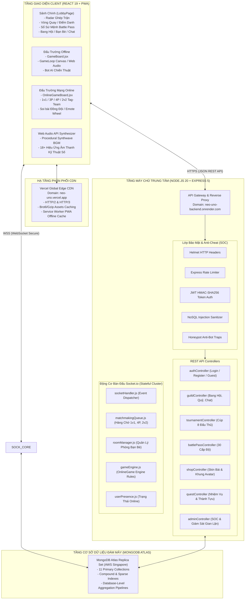
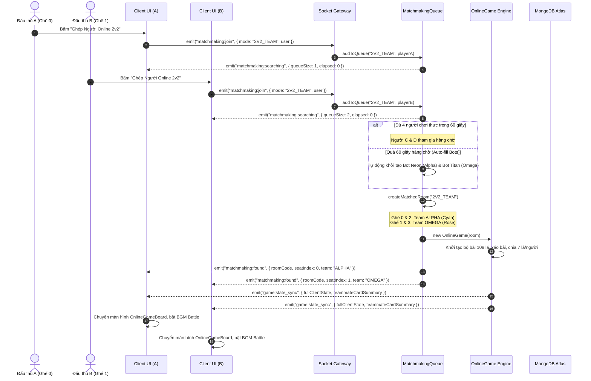
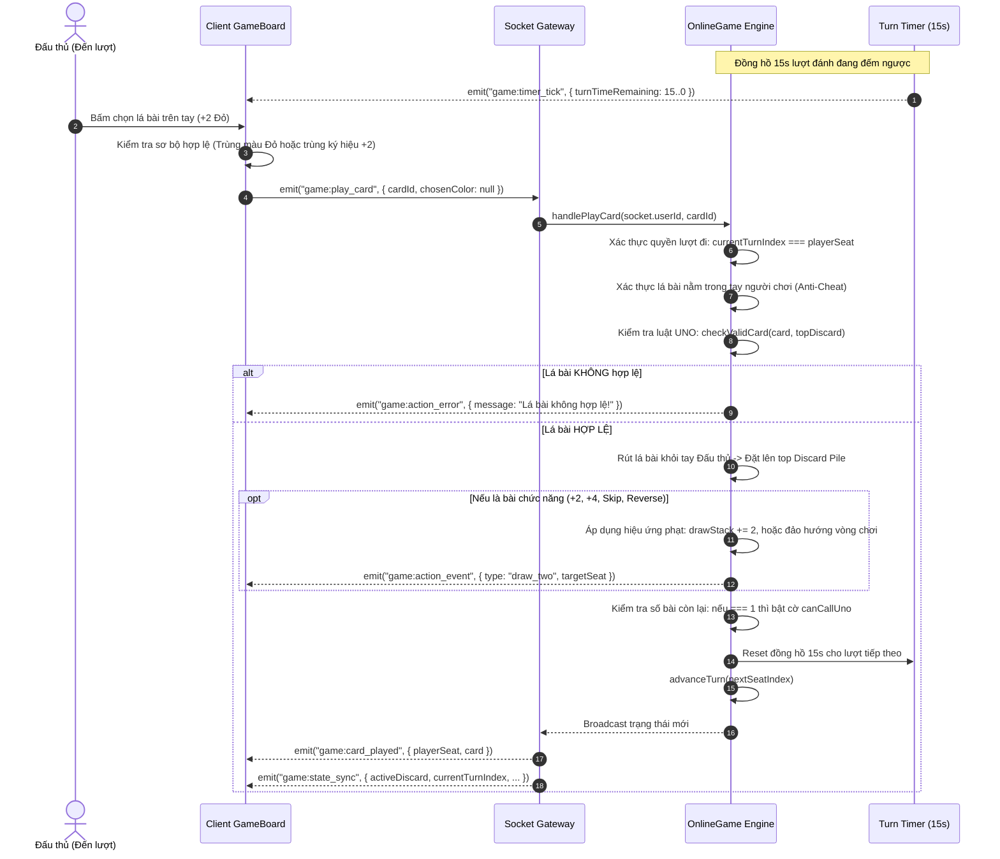
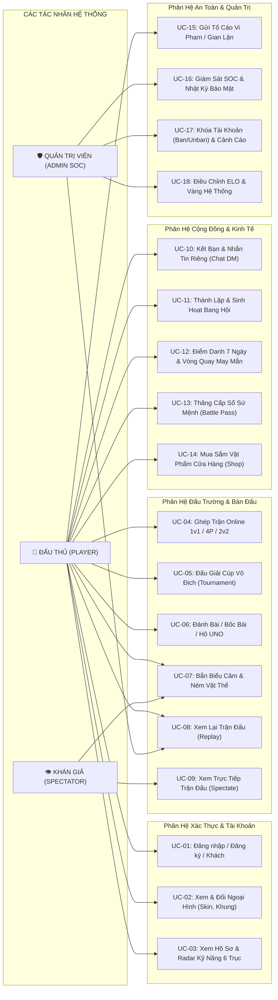
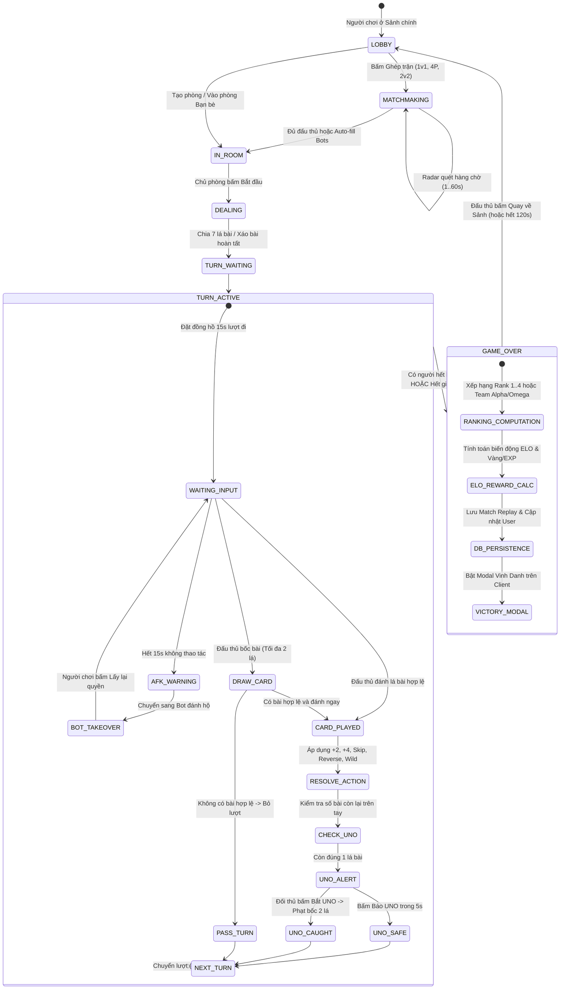

# SƠ ĐỒ KIẾN TRÚC KỸ THUẬT & CƠ SỞ DỮ LIỆU ERD (TASK 3 - TUẦN 6)
**Dự Án:** NEO-UNO — Cyberpunk Real-time Card Game Platform  
**Phiên bản:** v1.0.0 (Production Release)  
**Tác giả:** Đội ngũ phát triển NEO-UNO  
**Ngày cập nhật:** 20/11/2026  

---

## MỤC LỤC
1. [Tổng Quan Kiến Trúc Hệ Thống (System Architecture)](#1-tổng-quan-kiến-trúc-hệ-thống)
2. [Sơ Đồ Thực Thể Mối Quan Hệ CSDL (ERD - Entity Relationship Diagram)](#2-sơ-đồ-thực-thể-mối-quan-hệ-csdl-erd)
3. [Từ Điển Dữ Liệu Chi Tiết (Data Dictionary)](#3-từ-điển-dữ-liệu-chi-tiết)
4. [Sơ Đồ Tuần Tự Luồng Ghép Trận & Phòng Đấu (Matchmaking Sequence)](#4-sơ-đồ-tuần-tự-ghép-trận--tạo-phòng)
5. [Sơ Đồ Tuần Tự Vòng Lặp Lượt Đánh & Xử Lý Lá Bài (Game Turn Loop Sequence)](#5-sơ-đồ-tuần-tự-vòng-lặp-lượt-đánh)
6. [Sơ Đồ Tuần Tự Báo UNO & Phân Định Thắng Thua (UNO Shout & End Game Sequence)](#6-sơ-đồ-tuần-tự-báo-uno--kết-thúc-trận)
7. [Bảng Tra Cứu Sự Kiện WebSocket Socket.io (Socket Event Reference)](#7-bảng-tra-cứu-sự-kiện-socketio)

---

## 1. TỔNG QUAN KIẾN TRÚC HỆ THỐNG

NEO-UNO được xây dựng theo mô hình **Client-Server kiến trúc phân tán thời gian thực** (Distributed Real-time Gaming Architecture) kết hợp giữa RESTful API cho các tác vụ quản trị, dữ liệu bền vững và WebSocket (Socket.io) cho động cơ bàn đấu thời gian thực:



---

## 2. SƠ ĐỒ THỰC THỂ MỐI QUAN HỆ CSDL (ERD)

Cơ sở dữ liệu của NEO-UNO được thiết kế trên mô hình dữ liệu phi quan hệ (Document-based NoSQL) nhưng có cấu trúc định chuẩn nghiêm ngặt (Schema Validation), hỗ trợ các mối quan hệ thực thể 1-1, 1-N, N-N và các cấu trúc nhúng (Embedded Subdocuments):

```mermaid
erDiagram
    USER ||--o{ MATCH : "tham gia ván đấu"
    USER ||--o| GUILD : "gia nhập / lãnh đạo"
    USER ||--o{ FRIENDSHIP : "gửi / nhận kết bạn"
    USER ||--o{ DIRECT_MESSAGE : "gửi / nhận tin nhắn"
    USER ||--o{ TOURNAMENT : "tổ chức / vô địch cúp"
    USER ||--o{ REPORT : "tố cáo / bị tố cáo"
    USER ||--o{ SECURITY_LOG : "sinh nhật ký bảo mật"
    USER ||--o{ USER_ACHIEVEMENT : "mở khóa thành tựu"
    USER ||--o{ USER_QUEST : "thực hiện nhiệm vụ"
    MATCH ||--o{ REPORT : "liên quan đến báo cáo"

    USER {
        ObjectId _id PK
        string accountId UK "Mã tài khoản 10 ký tự duy nhất"
        string nickname "Tên hiển thị người chơi (1-40 ký tự)"
        string email UK "Địa chỉ email đăng nhập"
        string password "Mật khẩu băm Bcrypt"
        string googleId UK "ID xác thực liên kết Google OAuth"
        string authProvider "local | google | guest"
        string avatar "avatar_1 .. avatar_16"
        number elo "Điểm xếp hạng ELO (0 - 4000, mặc định 1000)"
        number coins "Số dư Vàng (chống âm)"
        number level "Cấp độ tài khoản"
        number exp "Kinh nghiệm tích lũy"
        number matchesWon "Số trận thắng"
        number matchesLost "Số trận thua"
        number tournamentsWon "Số cúp vô địch Tournament"
        string_array tournamentCups "Danh sách mã cúp vô địch"
        string role "player | admin | guest | bot"
        boolean isBanned "Cờ khóa tài khoản"
        string banReason "Lý do khóa tài khoản"
        boolean isFlagged "Cờ nghi vấn gian lận SOC"
        string_array cheatWarnings "Lịch sử cảnh báo gian lận"
        string_array inventory "Kho Skin và Khung Avatar sở hữu"
        string equippedCardSkin "Skin mặt lưng bài đang dùng"
        string equippedAvatarFrame "Khung avatar đang dùng"
        string equippedTitle "Danh hiệu Cyberpunk đang dùng"
        date lastDailySpinAt "Thời điểm quay vòng quay gần nhất"
        number checkInStreak "Chuỗi điểm danh liên tục (1-7 ngày)"
        string lastCheckInDate "Ngày điểm danh gần nhất (YYYY-MM-DD)"
        object battlePass "Embedded: Cấp độ, Season EXP, Luồng VIP"
        object guild "Embedded: ID bang, Tag bang, Vai trò bang"
        date lastLoginAt "Thời điểm đăng nhập gần nhất"
        date createdAt "Ngày tạo tài khoản"
        date updatedAt "Ngày cập nhật gần nhất"
    }

    MATCH {
        ObjectId _id PK
        string roomCode "Mã phòng đấu (hoặc SOLO_BOT)"
        string mode "1v1 | 3p | 4p | 2v2 | custom"
        object winner "ID, Tên, Cờ người/bot của người thắng"
        string reason "out_of_cards | timeout | forfeit_afk | player_quit"
        number durationSeconds "Thời lượng trận đấu tính bằng giây"
        matchPlayer_array players "Embedded: 2-4 người chơi, Hạng 1-4, Điểm số, Biến động ELO/Vàng/EXP"
        object initialState "Embedded: Người đi đầu, Lá khởi đầu, Bài trên tay ban đầu"
        turnLog_array turnLogs "Embedded: Lịch sử từng lượt đánh phục vụ Replay"
        date createdAt "Thời điểm diễn ra trận đấu"
    }

    GUILD {
        ObjectId _id PK
        string name "Tên Bang Hội (1-60 ký tự, hỗ trợ tiếng Việt)"
        string tag UK "Tag viết tắt độc nhất (1-30 ký tự, VD: VICECITY)"
        string slogan "Châm ngôn hoạt động của Bang"
        string emblem "Biểu tượng huy hiệu (Emoji / Icon)"
        ObjectId leaderId FK "ID Bang Chủ (User)"
        number level "Cấp độ Bang (1 - 10)"
        number exp "Kinh nghiệm cống hiến Bang"
        number treasuryCoins "Quỹ Vàng Bang Hội"
        number maxMembers "Số thành viên tối đa (15, 25, 40...)"
        guildMember_array members "Embedded: Danh sách thành viên, Chức vụ, Điểm cống hiến"
        guildChatMessage_array chatMessages "Embedded: Kênh chat nội bộ thời gian thực"
        date createdAt "Ngày thành lập Bang"
    }

    FRIENDSHIP {
        ObjectId _id PK
        ObjectId requester FK "Người gửi lời mời kết bạn (User)"
        ObjectId recipient FK "Người nhận lời mời kết bạn (User)"
        string status "pending | accepted | declined | blocked"
        date createdAt "Thời điểm gửi lời mời"
        date updatedAt "Thời điểm chấp nhận"
    }

    DIRECT_MESSAGE {
        ObjectId _id PK
        ObjectId sender FK "Người gửi tin nhắn (User)"
        ObjectId recipient FK "Người nhận tin nhắn (User)"
        string content "Nội dung tin nhắn (tối đa 500 ký tự)"
        boolean isRead "Trạng thái đã đọc"
        date readAt "Thời điểm đã đọc"
        date createdAt "Thời điểm gửi tin"
    }

    TOURNAMENT {
        ObjectId _id PK
        string tournamentId UK "Mã định danh giải đấu duy nhất"
        string title "Tên giải đấu Cúp Vô Địch"
        string season "Mùa giải hiện tại"
        string creatorId FK "ID người chơi tổ chức giải"
        string status "waiting | in_progress | completed | cancelled"
        number currentRound "1: Tứ kết, 2: Bán kết, 3: Chung kết, 4: Kết thúc"
        participant_array participants "Embedded: 8 đấu thủ (Hạt giống Seed 1-8)"
        tournamentMatch_array matches "Embedded: 7 trận đấu trong cây phân nhánh Knockout"
        object champion "Embedded: Đấu thủ vô địch đoạt Cúp"
        object rewards "Embedded: Cơ cấu giải thưởng Quán quân / Á quân"
        date createdAt "Thời điểm tạo giải"
    }

    REPORT {
        ObjectId _id PK
        ObjectId reporter FK "Người gửi tố cáo (User)"
        string reporterName "Tên người tố cáo"
        ObjectId targetUser FK "Đối tượng bị tố cáo (User)"
        string targetUserName "Tên đối tượng bị tố cáo"
        ObjectId matchId FK "ID ván đấu xảy ra vi phạm (nếu có)"
        string roomCode "Mã phòng đấu liên quan"
        string reason "afk_delay | cheating_exploit | toxic_chat | teaming | other"
        string description "Mô tả chi tiết vi phạm"
        string status "pending | reviewing | resolved | dismissed"
        string resolutionAction "none | warn | temporary_ban | permanent_ban"
        string resolutionNotes "Ghi chú của Quản trị viên SOC"
        string resolvedBy "Tên Admin giải quyết"
        date resolvedAt "Thời điểm xử lý"
        date createdAt "Thời điểm gửi tố cáo"
    }

    SECURITY_LOG {
        ObjectId _id PK
        ObjectId userId FK "Người chơi liên quan (User)"
        string action "SHOP_BUY | ADMIN_BAN_USER | NOSQL_INJECTION_BLOCKED..."
        string severity "info | warning | critical"
        object details "Chi tiết gói tin, IP, Payload, Số dư trước/sau"
        string ipAddress "Địa chỉ IP client"
        string userAgent "Trình duyệt / Thiết bị"
        string performedBy "Người thực hiện hành động"
        date createdAt "Thời điểm ghi nhận nhật ký"
    }

    USER_ACHIEVEMENT {
        ObjectId _id PK
        ObjectId userId FK "Chủ sở hữu thành tựu (User)"
        string achievementId "Mã định danh thành tựu (VD: FIRST_BLOOD)"
        string title "Tên thành tựu Cyberpunk"
        string badge "Huy hiệu thành tựu"
        number currentProgress "Tiến độ hiện tại"
        number targetProgress "Chỉ tiêu cần đạt"
        boolean isUnlocked "Trạng thái đã hoàn thành"
        date unlockedAt "Thời điểm mở khóa"
        boolean isClaimed "Trạng thái đã nhận thưởng"
        date claimedAt "Thời điểm nhận thưởng"
    }

    USER_QUEST {
        ObjectId _id PK
        ObjectId userId FK "Chủ sở hữu nhiệm vụ (User)"
        string questDate "Ngày nhiệm vụ (YYYY-MM-DD)"
        questItem_array quests "Embedded: Danh sách 4 nhiệm vụ ngày (Bốc bài, Hô UNO, Thắng ván...)"
        boolean chestClaimed "Trạng thái đã mở Rương Ngày"
        date chestClaimedAt "Thời điểm mở rương"
    }
```



---

## 3. TỪ ĐIỂN DỮ LIỆU CHI TIẾT (DATA DICTIONARY)

### 3.1. Bảng `users` (Tài khoản người chơi & Tiến trình)
| Tên Cột (Field) | Kiểu Dữ Liệu | Ràng Buộc | Mô Tả Nghiệp Vụ |
| :--- | :---: | :---: | :--- |
| `_id` | `ObjectId` | Primary Key | Khóa chính MongoDB tự sinh |
| `accountId` | `String` | Unique, Sparse, 10 chars | Mã căn cước số Cyber ID độc nhất |
| `nickname` | `String` | Required, 1-40 chars | Tên hiển thị người chơi, hỗ trợ tiếng Việt |
| `email` | `String` | Required, Unique, Lowercase | Email xác thực tài khoản |
| `password` | `String` | Min 6 chars (nếu local) | Mật khẩu băm Bcrypt 10 rounds |
| `authProvider` | `String` | Enum: `['local','google','guest']` | Phương thức xác thực danh tính |
| `elo` | `Number` | Default 1000, 0 - 4000 | Điểm kỹ năng xếp hạng đấu trường |
| `coins` | `Number` | Default 1000, Min 0 | Số dư Vàng kinh tế (chống âm tiền) |
| `role` | `String` | Enum: `['player','admin','guest','bot']` | Phân quyền bảo mật hệ thống |
| `isBanned` | `Boolean` | Default false | Khóa truy cập toàn diện khi vi phạm |
| `battlePass.level`| `Number` | Default 1, Max 30 | Cấp độ Sổ Sứ Mệnh mùa hiện tại |
| `battlePass.isPremium`| `Boolean`| Default false | Đã kích hoạt gói VIP Sổ Sứ Mệnh hay chưa |
| `guild.guildId` | `ObjectId` | Ref `Guild` | Bang hội người chơi đang tham gia |
| `guild.role` | `String` | Enum: `['leader','officer','member']` | Chức vụ trong Bang Hội |

### 3.2. Bảng `matches` (Lịch sử trận đấu & Dữ liệu Replay)
| Tên Cột (Field) | Kiểu Dữ Liệu | Ràng Buộc | Mô Tả Nghiệp Vụ |
| :--- | :---: | :---: | :--- |
| `roomCode` | `String` | Index | Mã phòng đấu Online hoặc SOLO_BOT |
| `mode` | `String` | Enum: `['1v1','3p','4p','2v2','custom']` | Thể thức thi đấu |
| `winner` | `Object` | Required `{id, name, isHuman}` | Thông tin đấu thủ giành chiến thắng |
| `reason` | `String` | Enum: `['out_of_cards','timeout',...]` | Lý do kết thúc trận đấu |
| `durationSeconds`| `Number` | Default 0 | Thời lượng ván đấu tính bằng giây |
| `players` | `Array` | Subdocuments | Thông tin 2-4 đấu thủ, Rank 1-4, $\Delta ELO$ |
| `turnLogs` | `Array` | Subdocuments | Lịch sử chi tiết từng nước bài phục vụ Replay |

### 3.3. Bảng `guilds` (Bang hội & Quân đoàn Cyberpunk)
| Tên Cột (Field) | Kiểu Dữ Liệu | Ràng Buộc | Mô Tả Nghiệp Vụ |
| :--- | :---: | :---: | :--- |
| `name` | `String` | Required, 1-60 chars | Tên Bang Hội |
| `tag` | `String` | Required, Unique, 1-30 chars | Tag đại diện viết tắt (VD: `[VICECITY]`) |
| `emblem` | `String` | Default '🛡️' | Huy hiệu biểu tượng Bang |
| `leaderId` | `ObjectId` | Required, Ref `User` | ID Bang Chủ sáng lập |
| `level` | `Number` | 1 - 10, Default 1 | Cấp độ Bang Hội |
| `treasuryCoins` | `Number` | Default 0, Min 0 | Quỹ Vàng thành viên cống hiến |
| `members` | `Array` | Subdocuments | Danh sách thành viên, ngày gia nhập, cống hiến |
| `chatMessages` | `Array` | Subdocuments (Max 300) | Kênh chat nội bộ thời gian thực |

---

## 4. SƠ ĐỒ TUẦN TỰ GHÉP TRẬN & TẠO PHÒNG

Quy trình ghép trận tự động đa người chơi (Matchmaking Queue) và khởi tạo phòng đấu 2v2 Tag-Team hoặc 1v1 / 4P:



---

## 5. SƠ ĐỒ TUẦN TỰ VÒNG LẶP LƯỢT ĐÁNH

Quy trình đánh bài, kiểm tra tính hợp lệ chống gian lận, kích hoạt hiệu ứng lá bài phạt (+2, +4, Skip, Reverse) và chuyển lượt:



---

## 6. SƠ ĐỒ TUẦN TỰ BÁO UNO & KẾT THÚC TRẬN

Cơ chế đếm ngược 5 giây bắt buộc hô UNO, xử lý bắt phạt khi quên hô, và lưu trữ lịch sử trận đấu khi ván bài kết thúc:

```mermaid
sequenceDiagram
    autonumber
    actor PlayerA as Đấu thủ A (Còn 1 lá)
    actor PlayerB as Đấu thủ B (Đối thủ)
    participant ClientA as Client UI (A)
    participant ClientB as Client UI (B)
    participant Engine as OnlineGame Engine
    participant DB as MongoDB Atlas

    PlayerA->>ClientA: Đánh lá áp chót (Bài trên tay còn đúng 1 lá)
    ClientA->>Engine: emit("game:play_card", card)
    Engine->>Engine: Phát hiện PlayerA.handCount === 1
    Engine-->>ClientA: emit("game:uno_warning", { seatIndex: 0, timeLimit: 5 })
    Engine-->>ClientB: emit("game:uno_warning", { seatIndex: 0, timeLimit: 5 })

    alt Kịch bản 1: Player A kịp bấm "BÁO UNO" trong 5s
        PlayerA->>ClientA: Bấm nút "BÁO UNO"
        ClientA->>Engine: emit("game:call_uno")
        Engine->>Engine: Đánh dấu PlayerA.unoCalled = true
        Engine-->>ClientA: emit("game:uno_called", { seatIndex: 0, success: true })
        Engine-->>ClientB: emit("game:uno_called", { seatIndex: 0, success: true })
    else Kịch bản 2: Quá 5s Player A quên bấm -> Player B "BẮT UNO"
        PlayerB->>ClientB: Bấm nút "BẮT UNO"
        ClientB->>Engine: emit("game:catch_uno", { targetSeatIndex: 0 })
        Engine->>Engine: Phạt PlayerA bốc 2 lá bài vào tay
        Engine-->>ClientA: emit("game:uno_penalized", { targetSeat: 0, penaltyCards: 2 })
        Engine-->>ClientB: emit("game:uno_penalized", { targetSeat: 0, penaltyCards: 2 })
    end

    Note over PlayerA,Engine: Trận đấu tiếp diễn cho đến khi có người hết bài (0 lá)
    PlayerA->>ClientA: Đánh lá bài cuối cùng
    ClientA->>Engine: emit("game:play_card", finalCard)
    Engine->>Engine: finishGame(winnerPlayerA)

    alt Chế độ 2v2 Tag-Team
        Engine->>Engine: Team Alpha (Ghế 0 & 2) Thắng! Cả 2 nhận thưởng thắng trận
        Engine->>Engine: MVP (Ghế 0): +30 ELO; Đồng đội (Ghế 2): +20 ELO
        Engine->>Engine: Team Omega: -10 ELO & -20 ELO
    else Chế độ Solo 1v1 / 4P
        Engine->>Engine: Rank 1: +30 ELO; Rank 2: +10 ELO; Rank 3: -10 ELO; Rank 4: -20 ELO
    end

    Engine->>DB: Match.create({ roomCode, mode, winner, players, turnLogs })
    Engine->>DB: User.updateMany (Cập nhật ELO, Vàng, Level, EXP, Season EXP)
    
    Engine-->>ClientA: emit("game:finished", { winner, rankings, rewards })
    Engine-->>ClientB: emit("game:finished", { winner, rankings, rewards })

    ClientA->>ClientA: Bật Modal Chiến Thắng / Vinh Danh Vô Địch
    ClientB->>ClientB: Bật Modal Kết Quả Trận Đấu
```

---

## 7. BẢNG TRA CỨU SỰ KIỆN WEBSOCKET (SOCKET.IO)

Hệ thống sự kiện Socket.io hai chiều giữa Client và Server:

| Tên Sự Kiện (Event Name) | Chiều (Direction) | Payload Chính | Mục Đích Nghiệp Vụ |
| :--- | :---: | :--- | :--- |
| `matchmaking:join` | Client $\rightarrow$ Server | `{ mode, user }` | Đăng ký hàng chờ ghép trận tự động |
| `matchmaking:searching` | Server $\rightarrow$ Client | `{ queueSize, elapsed }` | Cập nhật radar số lượng người đang tìm trận |
| `matchmaking:found` | Server $\rightarrow$ Client | `{ roomCode, seatIndex, team }` | Thông báo đã ghép thành công phòng đấu |
| `room:create` | Client $\rightarrow$ Server | `{ mode, isPrivate, password }` | Tạo phòng bạn bè Custom Room |
| `room:join` | Client $\rightarrow$ Server | `{ code, password, user }` | Gia nhập phòng bạn bè bằng mã 6 ký tự |
| `game:get_state` | Client $\rightarrow$ Server | `{ code, userId, playerName }` | Yêu cầu đồng bộ lại trạng thái bàn cờ |
| `game:state_sync` | Server $\rightarrow$ Client | `{ players, activeDiscard, myHand }` | Đồng bộ toàn diện bàn đấu thời gian thực |
| `game:play_card` | Client $\rightarrow$ Server | `{ cardId, chosenColor }` | Hành động đánh lá bài xuống bàn |
| `game:card_played` | Server $\rightarrow$ Client | `{ playerSeat, card }` | Phát sóng lá bài vừa được đánh |
| `game:draw_card` | Client $\rightarrow$ Server | `{ count: 1 }` | Hành động bốc bài từ chồng bài rút |
| `game:pass_turn` | Client $\rightarrow$ Server | `{}` | Bỏ lượt sau khi đã bốc đủ 2 lá |
| `game:call_uno` | Client $\rightarrow$ Server | `{}` | Đấu thủ hô UNO khi còn 1 lá |
| `game:catch_uno` | Client $\rightarrow$ Server | `{ targetSeatIndex }` | Bắt quả tang đối thủ quên hô UNO |
| `game:send_emote` | Client $\rightarrow$ Server | `{ emote, targetSeatIndex }` | Bắn biểu cảm hoặc ném đồ vật tương tác |
| `game:receive_emote` | Server $\rightarrow$ Client | `{ fromSeat, targetSeat, emote }` | Phát sóng chuyển động bay của vật thể |
| `game:afk_takeover_started` | Server $\rightarrow$ Client | `{ seatIndex, botName }` | Kích hoạt Bot đánh hộ khi người chơi AFK |
| `game:resume_control` | Client $\rightarrow$ Server | `{ code }` | Người chơi lấy lại quyền điều khiển từ Bot |
| `game:finished` | Server $\rightarrow$ Client | `{ winner, rankings, rewards }` | Kết thúc trận đấu và trao thưởng |

---

## 8. SƠ ĐỒ CA SỬ DỤNG TỔNG QUÁT (USE CASE DIAGRAM)

Hệ thống NEO-UNO phục vụ 3 nhóm tác nhân chính (Actors): **Đấu Thủ Thường (Player)**, **Khán Giả (Spectator)**, và **Quản Trị Viên An Ninh (Admin SOC)**:



---

## 9. SƠ ĐỒ MÁY TRẠNG THÁI BÀN ĐẤU (STATE MACHINE DIAGRAM)

Vòng đời của một bàn cờ thời gian thực trong động cơ `OnlineGame` từ khi khởi tạo đến khi lưu trữ dữ liệu Replay:



---

## 10. SƠ ĐỒ CÂY PHÂN RÃ CHỨC NĂNG HỆ THỐNG (FUNCTIONAL DECOMPOSITION)

Cấu trúc phân rã 7 phân hệ chức năng toàn diện của nền tảng NEO-UNO:

```mermaid
flowchart TD
    ROOT["NỀN TẢNG WEB GAME NEO-UNO"]

    M1["1. PHÂN HỆ SẢNH & TÀI KHOẢN"]
    M2["2. ĐỘNG CƠ BÀN ĐẤU & LUẬT UNO"]
    M3["3. ĐẤU MẠNG & PHÒNG BẠN BÈ"]
    M4["4. GIẢI ĐẤU TOURNAMENT CUP"]
    M5["5. CỘNG ĐỒNG & BANG HỘI"]
    M6["6. KINH TẾ & TIẾN TRÌNH GAME"]
    M7["7. BẢO MẬT SOC & QUẢN TRỊ"]

    ROOT --> M1
    ROOT --> M2
    ROOT --> M3
    ROOT --> M4
    ROOT --> M5
    ROOT --> M6
    ROOT --> M7

    M1 --> M1_1["Đăng ký / Đăng nhập JWT / Khách"]
    M1 --> M1_2["Hồ sơ Sự Nghiệp & Radar 6 Trục"]
    M1 --> M1_3["Kho Đồ: Skin Mặt Lưng & Khung Avatar"]
    M1 --> M1_4["Cài đặt Âm thanh Đa kênh BGM/SFX"]

    M2 --> M2_1["Bộ bài 108 lá UNO tiêu chuẩn"]
    M2 --> M2_2["Vòng lặp 15s & Đếm ngược 5 phút"]
    M2 --> M2_3["Xử lý bài phạt: +2, +4, Skip, Reverse"]
    M2 --> M2_4["Cơ chế 5s Hô UNO & Bắt Quả Tang"]
    M2 --> M2_5["Bot AI Offline & Chống AFK đánh hộ"]

    M3 --> M3_1["Radar Ghép trận 1v1, 4P, 2v2"]
    M3 --> M3_2["Phòng Bạn Bè 6 Ký Tự (Custom Room)"]
    M3 --> M3_3["Chế độ Khán Giả xem trực tiếp (Spectator)"]
    M3 --> M3_4["Bánh xe Biểu cảm & Ném Cà chua/Pháo hoa"]
    M3 --> M3_5["Xem lại ván đấu (Match Replay)"]

    M4 --> M4_1["Sơ đồ Phân Nhánh Knockout 8 Đấu Thủ"]
    M4 --> M4_2["Thuật toán Xếp Hạt Giống (Seed 1-8)"]
    M4 --> M4_3["Mô phỏng nhánh Bot song song thông minh"]
    M4 --> M4_4["Trao Cúp Quán Quân & Điểm ELO Đỉnh Cao"]

    M5 --> M5_1["Thành Lập Bang Hội (Tự do tên & Tag)"]
    M5 --> M5_2["Quỹ Cống Hiến & Thăng Cấp Bang 1-10"]
    M5 --> M5_3["Kênh Chat Nội Bộ Bang thời gian thực"]
    M5 --> M5_4["Bảng Xếp Hạng Bang Toàn Server"]
    M5 --> M5_5["Hệ thống Bạn bè & Nhắn tin riêng DM"]

    M6 --> M6_1["Vòng Quay May Mắn Cyber (Cooldown 24h)"]
    M6 --> M6_2["Điểm Danh 7 Ngày Tích Lũy Streak"]
    M6 --> M6_3["Sổ Sứ Mệnh Battle Pass 30 Cấp Độ"]
    M6 --> M6_4["Nhiệm Vụ Hàng Ngày & Rương Thưởng"]
    M6 --> M6_5["Bảng Xếp Hạng ELO Top 50 Server"]

    M7 --> M7_1["Trung Tâm An Ninh SOC & Nhật Ký Truy Vết"]
    M7 --> M7_2["Hệ Thống Tố Cáo Vi Phạm (Report Modal)"]
    M7 --> M7_3["Chặn Gian Lận ELO / Tiêu Âm Tiền Vàng"]
    M7 --> M7_4["Chống NoSQL Injection & Rate-Limiting"]
```



---
**Tài liệu này là một phần của Hồ Sơ Nghiệm Thu Kỹ Thuật Đồ Án NEO-UNO (Tuần 6).**
